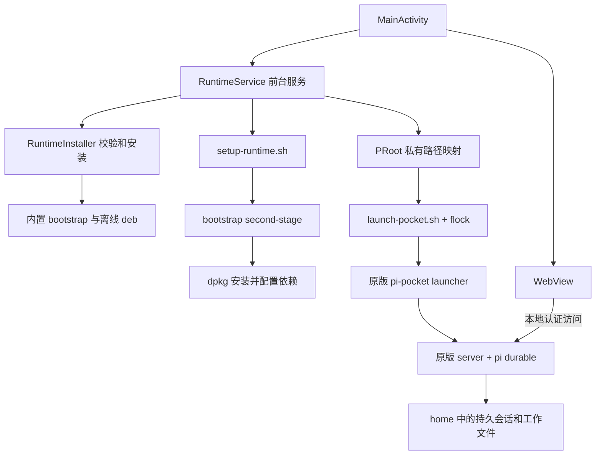

# 运行架构与升级边界

本文对应 pi-pocket `0.21.0` / `7d6fbb0fc07adf18fa2d8e23514092176e5b65d2`。描述来自宿主实现和该固定上游源码；Android 设备行为仍需按验收清单验证。

## 组件关系

Android Java 代码只承担组件安装、进程启动、状态显示和 WebView 宿主职责。服务端、前端、任务模型与存储恢复逻辑来自固定版本的上游；Android 层不另写一个替代服务端。应用包名 `io.github.mikyan.pipocket` 与官方 Termux 独立，PRoot 将本应用的私有目录映射到内置二进制预期的虚拟前缀。

## 构建输入

`scripts/prepare.py` 从 `upstream.lock.json` 指定的提交提取干净源码，用上游 `package-lock.json` 安装生产依赖。它保留源码字节，只对宿主脚本、Android 文件权限和跨平台 npm 命令链接进行打包处理。Windows 生成的 `.cmd`/`.bin` 启动器不直接当作 Android 命令，包内命令链接根据 npm 包元数据重建。

`runtime.lock.json` 记录 Termux bootstrap 和完整 Android 包闭包的版本与 SHA-256。`npm` 是显式依赖，其 `nodejs | nodejs-lts` 选择 LTS，避免引入两个互斥 Node 包。正常构建复用锁文件，更新依赖是维护者的显式操作。payload 包含 bootstrap、离线 `.deb`、原版 pi-pocket 与生产依赖、宿主脚本、权限和符号链接清单。

## 首次启动

1. `MainActivity` 展示准备状态并启动 `RuntimeService`。Service 立即显示系统运行状态通知。
2. 若已存在可用 owner token，先使用该 token 请求 `/api/me`。认证成功则连接原服务，避免另起一个任务进程。
3. 没有可复用服务时，检查端口和旧进程锁；安装器验证 payload ABI 与设备 ABI 匹配、payload SHA-256。
4. 文件先展开到 `usr.staging-<时间戳>`，应用清单权限，最后恢复符号链接。路径检查防止归档内容越过安装目录。
5. 完整目录切换到本应用 `files/usr` 后，在 PRoot 的虚拟 `/data/data/com.termux/files/usr` 中执行 bootstrap second-stage。它配置预装包的维护脚本，包括 termux-exec 与 alternatives。PRoot 本体、loader 与两个动态库在配置前从已校验 deb 提取，外层进程使用真实私有路径寻找它们。
6. 在设备上用 bootstrap 的 `dpkg` 安装并配置全部内置 `.deb`。因此包数据库、脚本、证书、链接和权限由实际包管理过程处理。
7. 安装脚本审计 dpkg 状态，并验证 Node 内建 SQLite、子进程调用及 git/ripgrep/fd/npm，成功后写入本运行环境的 `configured` 标记。这些设备端自检代码尚待真机实际运行验证。
8. `launch-pocket.sh` 使用 `flock` 持有 `home/.pi-pocket/android-host.lock`，启动原版 `bin/pi-pocket.js`。

配置失败不会写成功标记。bootstrap 自己的 second-stage 锁与本项目成功标记不是同一概念：上游锁在运行开始时创建，单凭锁存在不能证明配置完成。配置中断后的重试必须检查日志和实际包状态。

## 后端启动与认证

launcher 使用以下公开配置：本地访问、监听 `127.0.0.1:18787`、数据目录 `home/.pi-pocket`、默认工作目录 `home/workspace`，并跳过交互确认。宿主设置稳定的 HOME、PREFIX、PATH、TMPDIR 和环境变量；`PI_POCKET_GUARD=off` 是当前 Android 兼容设置。虚拟路径中的数据实际落在本应用私有目录；已有 Termux 的目录不作为绑定源。外层 PRoot 不使用 Termux 的 LD_PRELOAD，以避免干扰路径翻译。

上游需要 Node 22.19+ 的原生 TypeScript 支持、`node:sqlite` 和 `child_process`。它的 launcher 用子进程管理 server，因此仅有能执行部分 JavaScript 的引擎不够。

上游没有专用 `/health` 接口；初始化期间 HTTP 可以返回 503。宿主通过私有 `config.json` 的 owner token 请求 `/api/me`，收到 200 才视为当前实例就绪。单纯端口打开或任意网页返回 200 不能代替该检查。

WebView 进入 `/login?token=...`，让上游设置自身登录 Cookie，再跳回主页。token 不交给外部浏览器；宿主日志遮盖已识别的 token 参数。WebView 禁止 file/content 访问、第三方 Cookie 和通用文件源访问，不向网页暴露 shell JavaScript bridge。非本地的主框架链接交给系统浏览器；文件上传通过 Android 文件选择器提供。该策略仍需真机验证 WebView 重定向、Cookie 与生命周期行为。

## 进程与 durable 恢复

原版 launcher 负责上游内部重启协议和异常退出重试。Android Service 负责重新进入应用时发现或启动 launcher。Activity 重建、返回前台、WebView 重建均不清空 HOME 或数据库。`flock` 防止多个宿主启动同一数据目录；上游自身的运行锁仍保持原行为。

恢复流程为：打开同一个 `pocket.sqlite`，由上游恢复会话、run、subagents 和归属，再调用 durable harness 的恢复入口。宿主不会通过重新发消息或构造新会话替代这一流程。

持久化不等于保存整个进程。进行中的网络连接、浏览器实例和本机进程内存可以丢失。可安全重放步骤由上游处理；不安全的工具调用可能成为 `interrupted`。例如外部副作用已经发生但结果尚未提交时，不能笼统承诺恰好执行一次。验证必须检查任务进度和工具结果，不能只检查聊天历史还在。

前台 Service 和 `START_STICKY` 不保证无限后台运行，也不改变 Android 的用户强行停止语义。正常使用目标是：任务状态尽量持续保存，进程消失后手动重开能从上游持久状态恢复。

## 目录与升级事务

| 路径（相对应用 `files/`） | 内容 | 升级处理 |
| --- | --- | --- |
| `usr/` | 可替换的运行环境、工具、上游代码 | 校验新 payload 后切换 |
| `home/.pi-pocket/` | 数据库、任务、配置与应用数据 | 保留，并在切换前备份 |
| `home/.pi/agent/` | 提供商授权等 Pi 配置 | 保留，并在切换前备份 |
| `home/workspace/` | 用户项目与文件 | 保留；不纳入自动配置备份 |
| `backups/<时间戳>/` | 升级前的 pi-pocket/pi-agent 快照与记录 | 保留；不自动恢复 |
| `usr.previous-<时间戳>/` | 切换前运行环境 | 保留；不自动搭配新数据库启动 |
| `.pocket-runtime-switch.json` | 目录切换日志 | 用于处理中断的目录切换 |

升级前必须没有进程持有运行环境锁。若当前旧服务仍健康，宿主会先连接它并提示完整停止后再安装组件，避免任务执行时更换运行文件。切换前复制两份配置/数据目录；目录重命名中断时，安装器可恢复之前保留的运行环境目录。

目录恢复与数据库降级是不同操作。新上游可能进行单向 schema 迁移；仅恢复 `usr.previous-*` 不能撤销迁移。本项目不自动还原旧数据库。需要回退时，应在确认影响后同时选择匹配的运行环境与迁移前数据备份，并保留失败现场。

维护上游升级时，更新 `upstream.lock.json` 到经过验证的新提交和版本，重新执行 prepare、契约测试、APK 构建与设备升级测试。更新 Android 运行包时才显式更新 `runtime.lock.json`。修改的是宿主输入锁和构建产物，上游源码保持独立。

## 已知适配边界

- 应用使用独立包名与 UID；官方二进制的固定前缀通过 PRoot 进程内映射兼容。两个应用能够同装，实际子进程执行仍需模拟器及 ARM64 设备验证。
- `targetSdk=28` 是侧载兼容路线。Android 对现代 targetSDK 限制执行可写目录的二进制；长期需要 APK 原生库目录分发或其他重新设计，不能只提高 Gradle 数字。
- Guard 关闭，生产安装省略 optional 包与 npm 生命周期脚本。依赖这些能力的上游功能不在已验证范围。
- 语音、网页推送通知、Android 分享接收、下载和浏览器自动化尚未适配。文件选择器已有实现，但仍需要真机验收。
- 当前没有 ARM64 真机通过记录；CI x86_64 模拟器的启动和同装记录应单独引用，不等于所有手机或全部桌面功能已经验证。

参考：[Android 可执行文件限制](https://developer.android.com/about/versions/10/behavior-changes-10#execute-permission)、[Termux 固定前缀与 fork](https://github.com/termux/termux-app#forking)、[Termux APKLF 方向](https://termux.dev/en/posts/general/2024/11/11/termux-selected-for-nlnet-ngi-mobifree-grant.html)、[Android 进程生命周期](https://developer.android.com/guide/components/activities/process-lifecycle)。
