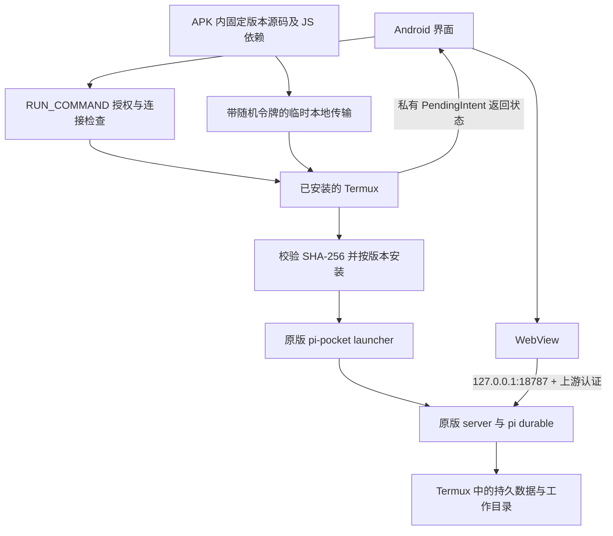

# 运行架构

当前架构为依赖外部 Termux 的 0.3 系列。上游版本与提交以 `upstream.lock.json` 为准。

## Android 与 Termux 的职责

Android 应用不执行嵌入式 Linux 二进制，也不再展开 bootstrap 或使用 PRoot。它检测官方 Termux 命令服务、请求 `com.termux.permission.RUN_COMMAND`，发送明确的 bash 命令，并显示原版 Web 前端。实际 Node 进程和文件工具属于 Termux UID。

Termux 还要求 `~/.termux/termux.properties` 中的 `allow-external-apps=true`。宿主不能在尚未授权时直接读取 Termux 私有文件，也不会通过共享存储绕过命令权限。首次安装缺少的 Node、Git 等工具由 Termux 包管理器执行，不无条件重置已有 HOME 或升级整个 Termux 环境。

API 来自 [Termux RUN_COMMAND](https://github.com/termux/termux-app/wiki/RUN_COMMAND-Intent)。回调使用明确组件的 PendingIntent 和不导出的 receiver；返回的 owner token 存在宿主私有存储，不作为普通运行日志打印。宿主不提供网页到 shell 的 JavaScript bridge。

## 构建与导入

prepare 从锁定 Git 提交提取原样源码，用原始 `package-lock.json` 安装生产 JavaScript 依赖。`--omit=dev --omit=optional --ignore-scripts` 避免构建机平台的可选原生二进制和安装脚本进入设备。POSIX 命令链接按包元数据重建，许可证文本保留。

APK 含 `pocket.tar.gz`、`payload.json` 和宿主安装/启动脚本。payload schema 2 指明 `runtime=termux`、上游版本、提交、最低 Node、归档 SHA-256 和运行版本标识。构建审计检查路径和链接边界、核心源码一致性、哈希；Termux 导入再次核对哈希。

首次传输使用只绑定回环地址的短期 HTTP 服务，随机端口与高熵路径令牌只通过授权命令传给 Termux。该服务仅提供本次固定资产，不允许任意文件读取；完成或超时即关闭。它不向局域网公开安装包和凭据。

## 数据与进程

宿主专用根目录是 Termux 的 `~/.local/share/pi-pocket-android/`。`versions/` 保存按版本区分的代码，`data/` 保存上游持久状态，`workspace/` 为默认工作目录，`logs/` 保存运行输出。保留 Termux 原始 HOME，因此 Pi 的 `~/.pi/agent/` 与同环境内的 Pi 工具共用。

监听地址固定 `127.0.0.1:18787`，启动参数使用上游公开的 local access、data、cwd 选项，并设置 `PI_POCKET_GUARD=off`。Node 必须满足上游最低版本并能够加载 `node:sqlite`。宿主只有在 owner token 请求 `/api/me` 成功后才打开 `/login?token=...`，由上游建立 Cookie。

重复启动用专用目录内的锁序列化。关闭或强行停止 Android 壳应用不主动停止 Termux 后端；再次进入时验证认证接口并重连。Termux 被停止后则重新启动原版 launcher，沿用同一数据目录。宿主不向上游伪造任务恢复事件，也不重放用户消息。

## 版本切换

运行中的旧服务优先重连，安装新版 APK 不自动中断任务。用户在菜单明确选择重启后，只停止本宿主跟踪并核实的 pi-pocket 进程，再启动 APK 中的版本。其他 Termux 会话不属于停止目标。

代码安装与持久数据分离，升级不删除 workspace、Pi 配置或上游数据库。旧内置模式的宿主私有数据保持原位，不自动导入到 Termux。上游数据库迁移可能不可逆，本项目不自动将新数据库交给旧版本尝试回滚。

运行版本标识绑定归档与宿主脚本，避免同一上游版本的宿主修复被错误当作无需更新。切换版本前，在持有 server 锁且旧服务停止时，将专用 `data/` 归档到 `backups/`，排除锁和临时连接标记；失败则不启动新版本。工作目录及共享 Pi 配置不在该归档中，备份也不会自动还原。

## 权限与适配边界

Termux 的整个 HOME 及其已获授权的共享存储对工具可见，workspace 只是默认 cwd。独立 Android UID 的其他应用私有文件仍不可访问。WebView 禁止 file/content 文件源访问和第三方 Cookie；外部主框架链接交给系统浏览器，上传走系统文件选择器。

Android、Termux 与厂商电池管理都可能终止进程。持久化状态恢复不等于进程内存恢复，也不保证任意网络或 shell 副作用恰好一次。真正在执行的模型任务恢复需独立验收。

目前保留 minSdk 26、targetSdk 28 以控制侧载兼容变化。语音、网页推送、下载、分享接收和浏览器自动化不列为已完成适配；Guard 和可选原生依赖功能不在验证范围内。
